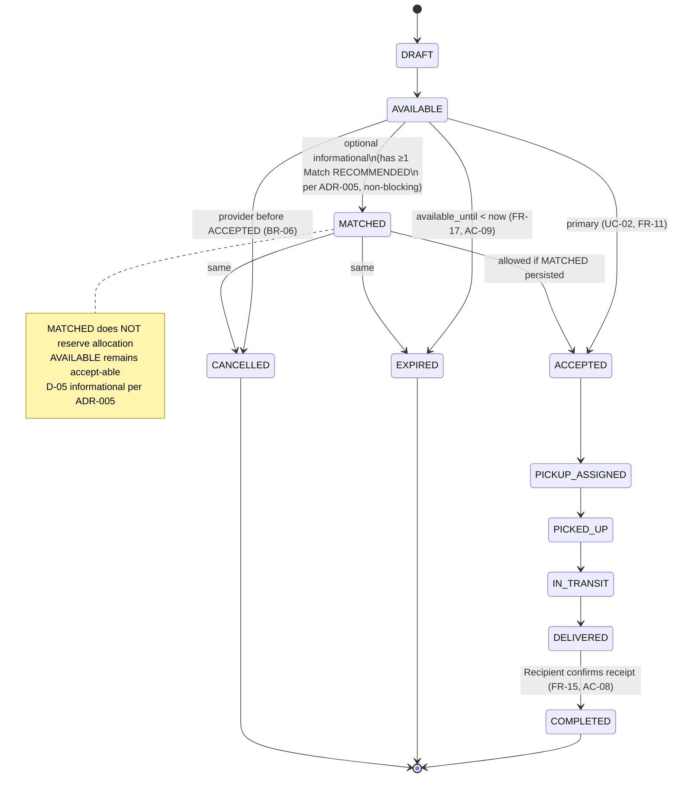
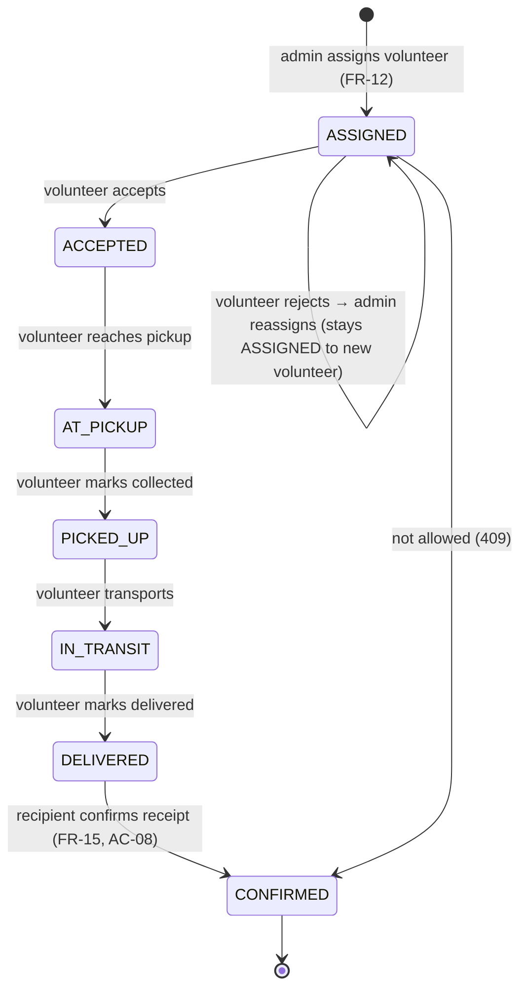

# Database Design — FWRP

**Source of truth:** `backend/prisma/schema.prisma` (Prisma 5.22, PostgreSQL 16)
**Phase:** DB-01..DB-13 complete (DB-13 transaction/concurrency), DB-12 indexes/constraints + CHECK intent deferred to DB-14
**Decisions:** ADR-004 (User↔Organization), ADR-005 (MATCHED informational), ADR-007 (Category String validation variant); D-05/D-08 resolved, D-06 unresolved (no Allocation)

---

## 1. Relationship Overview

All 9 domain models are implemented per PRD §24 and DB-01..DB-09. No speculative relations have been added. DB-10 verifies the intended relationship structure strictly from PRD, existing schema, and ADRs.

| # | Relationship | Type | PRD Authority | Status |
|---|--------------|------|---------------|--------|
| 1 | User ↔ Organization | N:1, nullable FK on User | PRD §24.1 `role` + §24.2 `verification_status`, ADR-004 | **Required, already implemented** — `User.organizationId String?` → `Organization.id` |
| 2 | User → Donation (provider) | 1:N | PRD §24.3 `provider_id`, BR-01 | **Required, already implemented** — `Donation.providerId` → `User.id`, `User.donations` |
| 3 | Organization → Requirement | 1:N | PRD §24.4 `organization_id`, FR-07 | **Required, already implemented** — `Requirement.organizationId` → `Organization.id`, `Organization.requirements` |
| 4 | Donation ↔ Requirement via Match | N:M through Match | PRD §24.5 `donation_id, requirement_id`, FR-09 | **Required, already implemented** — `Match.donationId` → `Donation`, `Match.requirementId` → `Requirement`, `Donation.matches`, `Requirement.matches` |
| 5 | Donation → Match | 1:N | PRD §24.5, DB-06 | **Required, already implemented** (same as 4, Donation side) |
| 6 | Requirement → Match | 1:N | PRD §24.5, DB-06 | **Required, already implemented** (same as 4, Requirement side) |
| 7 | Donation → Delivery | 1:N (allows reassignment) | PRD §24.6 `donation_id`, FR-12, DB-10 `1:1 or 1:N if reassignment allowed` | **Required, already implemented** — `Delivery.donationId` → `Donation`, `Donation.deliveries`; modeled as 1:N to allow reassignment without schema change |
| 8 | User → Delivery (volunteer) | 1:N | PRD §24.6 `volunteer_id`, FR-13, DB-07 | **Required, already implemented** — `Delivery.volunteerId` → `User.id`, `User.volunteerDeliveries`; reuses `User` (no separate Volunteer model per DB-07) |
| 9 | User → Notification | 1:N | PRD §24.7 `user_id`, §17, DB-08 | **Required, already implemented** — `Notification.userId` → `User.id`, `User.notifications` |
| 10 | User → AuditLog | 1:N, nullable FK | PRD §24.8 `user_id`, NFR-03/AC-11, DB-09 | **Required, already implemented** — `AuditLog.userId String?` → `User.id`, `User.auditLogs`; nullable for system actions (`SYSTEM_EXPIRE`) |
| 11 | Category ↔ Donation | Logical, **not FK**, String validation | PRD FR-05, §18, ADR-007 A' variant, DB-05 | **Intentionally not modeled as FK** — `Donation.category String` + `Requirement.foodCategory String` remain `String`, validated against active `Category` rows in `DON-01`; no `Category` relation, no join table, no `categoryId` FK. Documented as logical relationship only. |
| 12 | Category ↔ Requirement | Logical, **not FK** | Same as 11 | **Intentionally not modeled** — same String validation variant |
| 13 | AuditLog ↔ Donation/Requirement/etc. | Polymorphic logical | PRD §24.8 `entity_type + entity_id`, DB-09 | **Intentionally not modeled as FKs** — see §5 AuditLog design |
| 14 | Donation → Organization | — | — | **Not justified / must NOT be added** — Donation ownership is via `User.providerId` → `User.organizationId`; direct `Donation.organizationId` would duplicate D-03 chain |
| 15 | Allocation / quantity_remaining | — | D-06 | **Deferred because D-06 unresolved** — no `Allocation`, `quantity_remaining`, `DonationAllocation` tables; `Donation.quantity`/`Requirement.quantityRequired/quantityFulfilled` remain base Floats |
| 16 | Volunteer model | — | — | **Not justified** — volunteer is `User` with `Role.VOLUNTEER` (D-04), no separate `Volunteer` table per DB-07 spec |

---

## 2. Cardinalities

- **User : Organization = N:1** — `User.organizationId` nullable; `Organization.users` 1:N
- **User : Donation = 1:N** — `Donation.providerId` required; `User.donations` 1:N
- **Organization : Requirement = 1:N** — `Requirement.organizationId` required; `Organization.requirements` 1:N
- **Donation : Match = 1:N** — `Match.donationId` required; `Donation.matches` 1:N
- **Requirement : Match = 1:N** — `Match.requirementId` required; `Requirement.matches` 1:N
- **Donation : Requirement = N:M** — via `Match` (unique `@@unique([donationId, requirementId])` prevents duplicate pair)
- **Donation : Delivery = 1:N** — `Delivery.donationId` required; `Donation.deliveries` 1:N (allows reassignment; DB-10 `1:1 or 1:N` satisfied by 1:N)
- **User (Volunteer) : Delivery = 1:N** — `Delivery.volunteerId` required; `User.volunteerDeliveries` 1:N
- **User : Notification = 1:N** — `Notification.userId` required; `User.notifications` 1:N
- **User : AuditLog = 1:N** — `AuditLog.userId` nullable (`String?`); `User.auditLogs` 1:N
- **Category : Donation/Requirement = 0:N logical** — no FK, `String` validation only (see §4)

---

## 3. FK Relationships (actual Prisma `@relation` + `@@index`)

All FKs are `@relation(fields: [fk], references: [id])` with `String @id @default(cuid())` PKs, `@@map` snake_case tables, and `@@index` per DB-0X specs:

- `User.organizationId → Organization.id` (`@@index([organizationId])`)
- `Donation.providerId → User.id` (`@@index([providerId])`)
- `Requirement.organizationId → Organization.id` (`@@index([organizationId])`)
- `Match.donationId → Donation.id` (`@@index([donationId])`, part of `@@unique([donationId, requirementId])`)
- `Match.requirementId → Requirement.id` (`@@index([requirementId])`)
- `Delivery.donationId → Donation.id` (`@@index([donationId])`)
- `Delivery.volunteerId → User.id` (`@@index([volunteerId])`)
- `Notification.userId → User.id` (`@@index([userId, isRead, createdAt])` composite per DB-08)
- `AuditLog.userId → User.id` (nullable, `@@index([userId])`)

No cascade rules are hardcoded in Prisma schema for MVP (DB-12 will document `FK cascades/restricts`); Prisma defaults to `NoAction` pending DB-12.

---

## 4. Logical / Non-FK Relationships

**Category ↔ Donation / Requirement (String-validation variant, ADR-007):**

- **Not a DB FK.** `Donation.category` and `Requirement.foodCategory` are `String` columns, **not** `categoryId` FKs. `Category` is standalone (`model Category` with `name @unique`, `slug @unique`, `isActive`).
- **Logical relationship:** `DON-01` (and future `Requirement` validation) must check `Donation.category IN (SELECT name FROM categories WHERE isActive = true)` at application level. This satisfies FR-05 *configurable by administrator* without requiring a breaking FK migration for DB-05.
- **Diagram distinction:** Mermaid shows `Category ||--o{ Donation : "validates (String, logical, not FK)"` with dotted annotation; no solid FK line, no `categoryId` field on `Donation`/`Requirement`.
- **Why not FK now:** Keeps DB-05 lightweight (single table, no `Donation`/`Requirement` migration), preserves `D-08` Option A `A'` variant, and avoids speculative join tables. A follow-up FK (`categoryId`) can be considered as optional `DB-05b` later, but is **explicitly deferred** per DB-05 `did NOT produce`.

**AuditLog polymorphic targeting:**

- **Not a FK to each domain table.** `AuditLog.entityType String @map("entity_type")` + `AuditLog.entityId String @map("entity_id")` store polymorphic reference (e.g., `entityType="Donation", entityId="cuid..."`).
- **Logical relationship:** `AuditLog` logically audits `User, Organization, Donation, Requirement, Match, Delivery, Notification, Category` via `(entityType, entityId)`, **not** via `donationId`, `requirementId` FKs.
- **Diagram distinction:** `AuditLog` has solid FK **only** to `User` (`userId`), and dotted logical lines to other entities labeled `polymorphic (entityType+entityId)`.

---

## 5. AuditLog Relationship Design (DB-09/DB-10 Focus)

**What AuditLog *has*:**
- **Actual DB FK:** `AuditLog.userId String? → User.id` (`User.auditLogs`), nullable for system actions (`SYSTEM_EXPIRE` per audit design). Indexed: `@@index([userId])`.
- **Polymorphic logical reference:** `entityType String` + `entityId String` (`@@index([entityType])`, `@@index([entityId])`, `@@index([entityType, entityId])` composite, `@@index([timestamp])`). No FK constraint to `Donation`/`Requirement`/etc.

**Why AuditLog does NOT have direct FKs to Donation, Requirement, Match, Delivery, Notification, Organization, or Category:**
- **Generic audit trail:** Per PRD §24.8 `entity_type + entity_id` and NFR-03/AC-11/BR-08, audit must cover *all* important actions (auth, verify, donation create/edit/cancel/expire/complete, requirement create/edit, match accept, delivery assign/status/confirm, admin overrides, analytics exports) without polluting schema with 8 separate nullable FKs (`donationId?`, `requirementId?`, …) that would be mostly null and would require schema change for every new auditable entity.
- **Append-only intent:** DB-09 specifies append-only *intent* (`enforced in app + DB in Phase 16`). Enforcement is **deferred to Phase 16** per DB-09 spec — no service/middleware/trigger/DB `REVOKE UPDATE/DELETE` now. Adding FKs to every table would imply a generic polymorphic FK, which Prisma/PostgreSQL does not natively support (would require triggers or join table). The chosen `(entityType, entityId)` string pair is the Prisma-idiomatic polymorphic pattern.
- **Preserved DB-09 behavior:** `oldValue String? @map("old_value")`, `newValue String? @map("new_value")` store JSON-stringified diff, `timestamp DateTime @default(now()) @map("timestamp")` indexed. `AuditLog` is **not** updated/deleted via API; verification of append-only is Phase 16.

**What was deliberately NOT produced in DB-09/DB-10 for AuditLog:**
- ❌ No generic polymorphic FK (`@relation` to multiple models)
- ❌ No `AuditLog` relation to every domain model (`donation AuditLog[]` on each model)
- ❌ No `auditService`/`audit.service.ts` interface (built in Phase 3 `BE-AUDIT-*` per High-Level Dependency Graph, not DB-09)
- ❌ No triggers, `REVOKE`, or DB-level append-only enforcement (deferred to Phase 16)
- ❌ No `AuditLog` API/routes/controllers/services or transactional audit workflow

---

## 6. Focus / Produced / Did-Not-Produce (DB-10)

**Focus:** Relationship & ER documentation for the 9 implemented models, strictly from PRD §24, existing schema, and ADRs 004/005/007.

**Produced (this task DB-10):**
- This file `docs/database.md` — relationship overview, cardinalities, FK vs logical distinction, AuditLog design, ER diagrams (Mermaid + textual), deferred decisions
- No Prisma schema change required — verification that all required FKs/back-relations already exist and no speculative relations are needed

**Did NOT produce:**
- No `Allocation`, `quantity_remaining`, `DonationAllocation`, `RequirementAllocation`, or partial-fulfillment workflow (D-06 unresolved)
- No `Volunteer` model (reuses `User` per DB-07)
- No `Category` FK on `Donation`/`Requirement` (intentionally `String` per ADR-007)
- No `AuditLog` generic FK, service, triggers, or append-only enforcement
- No `Notification`/`Delivery`/`Match` workflow, API, service, or UI
- No matching algorithm, acceptance logic, or notification dispatch
- No migrations or live DB

---

## 7. ER Diagram

### 7.1 Mermaid ER Diagram (current implemented schema)

> Render with any Mermaid renderer (GitHub, VS Code Mermaid preview, `mermaid-cli`). Solid lines = DB FK (`@relation`), dotted lines = logical String-validation / polymorphic.

```mermaid
erDiagram
    User ||--o{ Donation : "provides (providerId)"
    User ||--o{ Delivery : "volunteers (volunteerId)"
    User ||--o{ Notification : "receives (userId)"
    User ||--o{ AuditLog : "acts (userId, nullable)"
    Organization ||--o{ User : "has many (organizationId, nullable)"
    Organization ||--o{ Requirement : "owns (organizationId)"
    Donation ||--o{ Match : "has many (donationId)"
    Requirement ||--o{ Match : "has many (requirementId)"
    Donation ||--o{ Delivery : "has many deliveries (donationId, 1:N for reassignment)"
    Category ||..o{ Donation : "validates (category String, logical, not FK)"
    Category ||..o{ Requirement : "validates (foodCategory String, logical, not FK)"
    AuditLog }o..|| User : "actor (userId FK)"
    AuditLog }o..o{ Donation : "polymorphic audited (entityType+entityId, logical)"
    AuditLog }o..o{ Requirement : "polymorphic audited (entityType+entityId, logical)"
    AuditLog }o..o{ Organization : "polymorphic audited (entityType+entityId, logical)"
    AuditLog }o..o{ Match : "polymorphic audited (entityType+entityId, logical)"
    AuditLog }o..o{ Delivery : "polymorphic audited (entityType+entityId, logical)"
    AuditLog }o..o{ Notification : "polymorphic audited (entityType+entityId, logical)"
    AuditLog }o..o{ Category : "polymorphic audited (entityType+entityId, logical)"

    User {
        string id PK "user_id"
        string name
        string email UK
        string phone
        string passwordHash "password_hash"
        enum Role role
        string organizationId FK "nullable"
        enum UserStatus status
        datetime createdAt
        datetime updatedAt
    }
    Organization {
        string id PK "organization_id"
        string name
        enum OrganizationType type
        string address
        float latitude
        float longitude
        string contactInformation "nullable"
        enum VerificationStatus verificationStatus
        datetime createdAt
        datetime updatedAt
    }
    Donation {
        string id PK "donation_id"
        string providerId FK
        string foodName
        string category "String, validated vs Category, not FK (ADR-007)"
        string foodType
        float quantity
        string unit
        datetime availableFrom
        datetime availableUntil
        string pickupLocation
        float pickupLatitude "nullable"
        float pickupLongitude "nullable"
        string storageRequirement "nullable"
        string description "nullable"
        enum DonationStatus status
        datetime createdAt
        datetime updatedAt
    }
    Requirement {
        string id PK "requirement_id"
        string organizationId FK
        string foodCategory "String, validated vs Category, not FK"
        string foodType
        float quantityRequired
        float quantityFulfilled
        datetime requiredBy
        enum Priority priority
        string location
        enum RequirementStatus status
        datetime createdAt
        datetime updatedAt
    }
    Category {
        string id PK "category_id"
        string name UK
        string slug UK
        boolean isActive
        datetime createdAt
        datetime updatedAt
    }
    Match {
        string id PK "match_id"
        string donationId FK
        string requirementId FK
        float matchingScore
        float distance
        enum MatchStatus status
        datetime createdAt
        datetime updatedAt
    }
    Delivery {
        string id PK "delivery_id"
        string donationId FK
        string volunteerId FK
        string pickupLocation
        string deliveryLocation
        datetime assignedAt
        datetime pickupTime "nullable"
        datetime deliveryTime "nullable"
        enum DeliveryStatus status
        string proofOfDelivery "nullable"
        string notes "nullable"
        datetime createdAt
        datetime updatedAt
    }
    Notification {
        string id PK "notification_id"
        string userId FK
        enum NotificationType type
        string title
        string message
        boolean isRead
        datetime createdAt
    }
    AuditLog {
        string id PK "log_id"
        string userId FK "nullable, system actions"
        string action
        string entityType
        string entityId
        string oldValue "nullable, JSON stringified"
        string newValue "nullable, JSON stringified"
        datetime timestamp
    }
```

**Notes:**
- `Category ||..o{ Donation/Requirement` uses `||..o{` (dotted) to indicate **logical** String validation, not a solid FK. No `categoryId` FK exists on `Donation`/`Requirement` per ADR-007 `A'` variant.
- `AuditLog }o..o{ Donation` etc. are dotted polymorphic logical references via `(entityType, entityId)`, not DB FKs. Only `AuditLog → User` is solid.
- `Donation ||--o{ Delivery` is `1:N` (not `1:1`) to allow reassignment per `DB-10` spec.

### 7.2 Textual ER Summary (for non-Mermaid consumers)

```
User (1) ──< Donation (N) [providerId]
User (1) ──< Delivery (N) [volunteerId]
User (1) ──< Notification (N) [userId]
User (1) ──< AuditLog (N) [userId, nullable]
Organization (1) ──< User (N) [organizationId, nullable]
Organization (1) ──< Requirement (N) [organizationId]
Donation (1) ──< Match (N) [donationId] ── Requirement (1) [requirementId]  — Donation N:M Requirement via Match
Donation (1) ──< Delivery (N) [donationId]
Category (1) ..< Donation (N) [category String, logical, validated vs Category.name where isActive=true, NOT FK]
Category (1) ..< Requirement (N) [foodCategory String, logical]
AuditLog (N) ..> User (1) [userId FK] + polymorphic ..> Donation/Requirement/Match/Delivery/Notification/Organization/Category/Category/User via (entityType, entityId) logical
```

---

## 8. Explicit Deferred Relationships / Decisions

| Deferred Item | Why Deferred | Owner Task | Current State |
|---------------|--------------|------------|---------------|
| `Allocation` / `quantity_remaining` / `DonationAllocation` / `RequirementAllocation` / multi-recipient fulfillment structures | **D-06 remains UNRESOLVED** (partial fulfillment). Checklist `REQ-08, ACCEPT-04, ANALYTICS-02/04` explicitly blocks allocation. DB-06 `quantityFulfilled` remains base `Float @default(0)`, not allocation table. | `D-06` + `REQ-08`/`ACCEPT-04` | **Not modeled** — intentionally absent in `backend/prisma/schema.prisma` |
| `Donation.category` → `Category` FK (`categoryId`) and `Requirement.foodCategory` → `Category` FK | **ADR-007 Option A String-validation variant** — DB-05 intentionally kept `String` + app-level validation; FK migration is optional `DB-05b` later, not DB-10 | `DB-05` (done as String), `DON-01` validation will wire | **Logical only** — no `@relation`, no `categoryId` field, no join table |
| `Volunteer` model / `Volunteer` membership table | Volunteer is `User` with `Role.VOLUNTEER` per D-04/DB-07; no separate `Volunteer` table per DB-07 spec | `DB-07` | **Not modeled** — `Delivery.volunteerId → User.id` |
| `AuditLog` generic polymorphic FK to every domain table | Prisma/PostgreSQL has no native polymorphic FK; would require 8 nullable FKs or triggers. PRD `entity_type + entity_id` string pair is the Prisma-idiomatic pattern; generic FK is not justified | `DB-09` (schema) / `Phase 16` (enforcement) | **Logical only** — `(entityType, entityId)` string pair, indexed `@@index([entityType])`, `@@index([entityId])`, `@@index([entityType, entityId])` |
| `AuditLog` service/middleware/trigger/append-only DB enforcement | DB-09 spec says `append-only constraint intent (enforced in app + DB in Phase 16)` — schema is foundation, enforcement deferred | `BE-AUDIT-*` (Phase 3), `Phase 16` | **Not produced** — `model AuditLog` only, no service, no `REVOKE`, no trigger |
| `Donation → Organization` direct FK | Ownership is `Donation.providerId → User.organizationId → Organization`; direct FK would duplicate D-03 chain | — | **Not modeled / must NOT be added** — would be speculative |
| `Donation ↔ Requirement` direct FK (outside `Match`) | N:M is via `Match` per DB-10, not direct FK | `DB-10` | **Not modeled** — N:M via `Match` only |
| PostGIS / geospatial index beyond `@@index([latitude, longitude])` | PRD `Haversine` fallback (D-07) does not require PostGIS; checklist says `geospatial index on (latitude, longitude)` as composite B-tree, not `GIST` | `D-07` | **Not modeled** — `@@index([latitude, longitude])` B-tree only |
| `DB-12` check constraints (`available_until > available_from`, `quantity > 0`, `latitude BETWEEN -90 AND 90`) and `DB-14` migrations | Prisma schema does not natively support `CHECK`; DB-12/DB-14 will add via migration (as documented in DB-03 `available_until > available_from` deferred note) | `DB-12`/`DB-14` | **Deferred** — not in `schema.prisma` |

---

## 9. Prisma Schema Verification (DB-10)

No schema change was required for DB-10 — inspection proved all required FKs/back-relations already exist and no speculative relations are justified.

- **File:** `backend/prisma/schema.prisma` — unchanged in this iteration (still 9 models, 10 enums, 408 lines before format)
- **Validation (if schema had changed, would run):** `npx prisma format`, `npx prisma validate` (dummy `DATABASE_URL`), `npx prisma generate`, `backend typecheck`, `backend tests`, `frontend typecheck/tests/lint` — **not re-run** because `schema.prisma` unchanged; documentation verified against current schema via `grep`/`Select-String` of `^model`/`^enum`/`@relation`/`@@index`
- **Preserved decisions:** D-05 `MATCHED` informational (Donation `MATCHED` non-blocking, `Match.RECOMMENDED` informational), D-08 `Category String` validation, D-06 unresolved (no Allocation)

---

## 12. Indexes & Constraints (DB-12)

**Objective (DB-12):** Define indexes/constraints — unique emails, FK cascades/restricts, CHECK `available_until > available_from`, CHECK `quantity > 0`, CHECK `latitude BETWEEN -90 AND 90` — with correct ownership between Prisma schema (supported) and DB migration (deferred).

**Decision:** Prisma 5.22.0 does **not** natively support PostgreSQL `CHECK` constraints via `schema.prisma` syntax (no `@@check`). DB-12 therefore implements **only** Prisma-supported constraints/indexes directly in the schema (unique, FK `onDelete`/`onUpdate`, indexes) and **documents + defers** `CHECK` constraints to **DB-14** migration/database layer, consistent with DB-03 wording `available_until > available_from is a required invariant but DB-level enforcement was explicitly deferred to DB-12/DB-14` and DB-12's role as constraint *definition*.

### 12.1 What DB-12 Implemented Directly in `backend/prisma/schema.prisma` (Prisma-supported)

**1. Unique emails — already exists, no duplicate added:**
- `User.email String @unique` — DB-12 verified via `@unique` (implicit unique index `users_email_key`), no duplicate `@@index([email])` or `@@unique([email])` added.

**2. FK cascades/restricts — added explicit `onDelete`/`onUpdate` per PRD/checklist, previously `NoAction` default:**

| FK | Prisma Relation | `onDelete` | `onUpdate` | Rationale |
|----|-----------------|------------|------------|-----------|
| `User.organizationId → Organization.id` (nullable) | `User.organization` | `SetNull` | `Cascade` | Nullable FK — preserve User if Organization deleted |
| `Donation.providerId → User.id` | `Donation.provider` | `Restrict` | `Cascade` | Prevent deleting provider with donations (BR-01) |
| `Requirement.organizationId → Organization.id` | `Requirement.organization` | `Restrict` | `Cascade` | Prevent deleting org with requirements |
| `Match.donationId → Donation.id` | `Match.donation` | `Cascade` | `Cascade` | If Donation deleted, its Matches removed |
| `Match.requirementId → Requirement.id` | `Match.requirement` | `Cascade` | `Cascade` | If Requirement deleted, its Matches removed |
| `Delivery.donationId → Donation.id` | `Delivery.donation` | `Restrict` | `Cascade` | Prevent deleting Donation with Deliveries (BR-06) |
| `Delivery.volunteerId → User.id` | `Delivery.volunteer` | `Restrict` | `Cascade` | Prevent deleting Volunteer with Deliveries |
| `Notification.userId → User.id` | `Notification.user` | `Cascade` | `Cascade` | If User deleted, Notifications removed |
| `AuditLog.userId → User.id` (nullable) | `AuditLog.user` | `SetNull` | `Cascade` | Preserve audit trail if User deleted |

All 9 FKs now have explicit `onDelete`/`onUpdate`; no speculative FKs added.

**3. Existing indexes preserved, no duplicates added:** Verified via `Select-String "@@index"` → 26 indexes total before and after: `User @@index([role])`, `@@index([organizationId])`; `Organization @@index([verificationStatus])`, `@@index([latitude, longitude])`; `Donation @@index([providerId])` etc.; `Requirement @@index([organizationId])` etc.; `Category @@unique([name])`, `@@unique([slug])`; `Match @@unique([donationId, requirementId])`, `@@index([donationId])` etc.; `Delivery @@index([donationId])` etc.; `Notification @@index([userId, isRead, createdAt])`; `AuditLog @@index([entityType])` etc. No duplicate `@@index([email])` added.

### 12.2 What DB-12 Documents/Defers to DB-14 Migration (CHECK Constraints)

Prisma 5.22 schema syntax **cannot** express `CHECK` — verified via Prisma docs (no `@@check`). Checklist DB-03 wording and DB-12's `CHECK ...` are therefore **required invariants** but **DB-level enforcement is intentionally deferred to DB-14** `Create and verify database schema/migrations` (where raw SQL `CHECK` will be added). DB-12's role is to **declare intent** in schema comments + this documentation, and rely on application-level validation (`BE-09 validateAvailabilityWindow`) until DB-14.

| CHECK | Field(s) | Intended SQL (DB-14 migration) | Schema Comment (DB-12) | Application Validation Until DB-14 |
|-------|----------|--------------------------------|------------------------|-------------------------------------|
| `available_until > available_from` | `Donation.availableFrom`, `Donation.availableUntil` | `CHECK (available_until > available_from)` on `donations` | `// DB-12: CHECK available_until > available_from (deferred to DB-14 migration, Prisma does not natively support CHECK)` on `Donation.availableUntil` | `BE-09 validateAvailabilityWindow` + `DON-01`/`EXP-02` |
| `quantity > 0` | `Donation.quantity` (`Float`) | `CHECK (quantity > 0)` on `donations` | `// DB-12: CHECK quantity > 0 (deferred to DB-14)` on `Donation.quantity` | Service validation |
| `quantityRequired > 0` | `Requirement.quantityRequired` | `CHECK (quantity_required > 0)` on `requirements` | `// DB-12: CHECK quantityRequired > 0 (deferred)` | Service validation |
| `quantityFulfilled >= 0` | `Requirement.quantityFulfilled` | `CHECK (quantity_fulfilled >= 0)` on `requirements` | `// DB-12: CHECK quantityFulfilled >= 0 (deferred)` | Service validation |
| `latitude BETWEEN -90 AND 90` | `Organization.latitude` (Float, required) | `CHECK (latitude BETWEEN -90 AND 90)` on `organizations` | `// DB-12: CHECK latitude BETWEEN -90 AND 90 (deferred)` on `Organization.latitude` | Service validation |
| `longitude BETWEEN -180 AND 180` | `Organization.longitude` | `CHECK (longitude BETWEEN -180 AND 180)` on `organizations` | `// DB-12: CHECK longitude BETWEEN -180 AND 180 (deferred)` | Service validation |
| `pickupLatitude BETWEEN -90 AND 90` (nullable) | `Donation.pickupLatitude Float?` | `CHECK (pickup_latitude IS NULL OR pickup_latitude BETWEEN -90 AND 90)` | `// DB-12: CHECK pickupLatitude BETWEEN -90 AND 90, pickupLongitude BETWEEN -180 AND 180 (deferred, nullable)` | Service validation |
| `pickupLongitude BETWEEN -180 AND 180` (nullable) | `Donation.pickupLongitude Float?` | Same as above for `pickup_longitude` | Same comment | Service validation |

**Why deferred, not weakened:** Invariant remains **required** (PRD FR-16 time-window, NFR-01, FR-04 quantity, §37/§39 geocoordinates). Deferral is intentional per `DB-03: Define available_from/available_until DateTime fields (Prisma-level); DB-level CHECK deferred to DB-12/DB-14` and `DB-12: indexes/constraints` sequencing — `DB-12` *defines* intent, `DB-14` *applies* it via `psql \d` verified migration. `BE-09/DON-01/EXP-02` rely on invariant once `DB-12/DB-14` complete; until then application-level `validateAvailabilityWindow` is the enforcement.

**D-06 gating:** `quantity > 0` applies only to **existing** `Donation.quantity` and `Requirement` quantity fields; **no** `quantity_remaining`/`Allocation`/`DonationAllocation` field or table was introduced — verified `grep -c "quantity_remaining"` → 0 as column (only `// D-06: No allocation...` comments). No `Allocation` model added. D-06 remains `| D-06 |` unresolved.

**Latitude scope:** `latitude BETWEEN -90 AND 90` applies only where `latitude` actually exists: `Organization.latitude` (required) and `Donation.pickupLatitude` (nullable); `Organization.longitude` and `Donation.pickupLongitude` correspondingly `BETWEEN -180 AND 180`. No `Category`, `Match`, `Delivery`, `Notification`, `AuditLog` latitude fields exist, so no CHECK added there.

### 12.3 Verification (DB-12)

- **File:** `backend/prisma/schema.prisma` — **only** DB-12-related changes: added `onDelete`/`onUpdate` to 9 relations + `// DB-12: CHECK ...` comments on 7 fields (8 logical CHECKs); no new `model`/`enum`/`field`/`@@index` beyond `onDelete`/`onUpdate` and comments; no duplicate `@@index([email])` added (would duplicate `@unique`); no `quantity_remaining`/`Allocation` added; still 9 models + 10 enums.
- **Validation:** `npx prisma format` → `Formatted`, `npx prisma validate` (dummy `DATABASE_URL`) → `valid 🚀`, `npx prisma generate` → `Generated`, `backend typecheck` → `PASS`, `backend tests` → `2 passed`, `frontend typecheck/tests/lint` → `PASS` (run because schema changed via `onDelete`).
- **Preserved decisions:** D-05 informational `MATCHED`, D-08 `Category String` validation, D-06 unresolved (no Allocation).

---

## 13. Transaction & Concurrency Requirements (DB-13)

**Objective (DB-13):** Document where row-level locking or optimistic concurrency is required (`ACCEPT`, assignment), choose isolation level, and note `audit`/`notification` transactional consistency requirement (per `TASK_CHECKLIST.md` Transaction Semantics). **Documentation/requirements only** — no Prisma schema change, no service/middleware/trigger/outbox implementation in DB-13.

**Decision:** No Prisma schema change required for DB-13. All transaction/concurrency requirements are documented here and will be enforced in Phase 3 `BE-09` / Phase 6 `DON-09/ACCEPT-06` / Phase 10 `LOG-06` and `Phase 16` audit hardening. `D-06` remains `| D-06 |` unresolved — no `Allocation`/`quantity_remaining` locking introduced.

### 13.1 Isolation Level

**Chosen baseline:** **PostgreSQL `READ COMMITTED`**

- **Why `READ COMMITTED` (default):** PostgreSQL `READ COMMITTED` is the default and is sufficient when combined with explicit row-level locks (`SELECT ... FOR UPDATE`) for the two shapes of concurrency in FWRP. It prevents dirty reads, is well-understood, has lower deadlock/serialization-failure rate than `SERIALIZABLE`, and matches Supabase PostgreSQL default. No PRD or `backend/src` evidence requires stronger isolation for MVP.
- **Why not `SERIALIZABLE` by default:** `SERIALIZABLE` would abort many concurrent `ACCEPT` attempts with `could not serialize access due to concurrent update` and requires application retry logic, without removing the need for explicit row locks for the `check-then-update` pattern (`SELECT` status → `UPDATE` to `ACCEPTED`). `SERIALIZABLE` is useful for pure optimistic retries, but FWRP's `ACCEPT` is better handled deterministically with `FOR UPDATE`. `SERIALIZABLE` remains an option if future load testing (`TEST-08`) shows `READ COMMITTED + FOR UPDATE` is insufficient, but is **not the baseline**.
- **Where row-level locking is still required despite `READ COMMITTED`:** `READ COMMITTED` alone does **not** prevent lost updates for `SELECT status WHERE id = ?` → `UPDATE status = 'ACCEPTED' WHERE id = ? AND status = 'AVAILABLE'` race. A concurrent `SELECT` can both see `AVAILABLE` before either `UPDATE` commits. Therefore **explicit `SELECT ... FOR UPDATE` on the protected row inside a transaction** is still required for `ACCEPT` and for `assignment` (see §13.2). Isolation level does not replace the lock.

**Prisma equivalent:** `prisma.$transaction(..., { isolationLevel: 'ReadCommitted' })` (Prisma `5.22` supports `ReadCommitted`, `RepeatableRead`, `Serializable`) — or rely on PostgreSQL default `READ COMMITTED` without specifying, and use `prisma.$queryRaw`/`SELECT ... FOR UPDATE` or `findUnique` + `update` with `where: { id, status: 'AVAILABLE' }` + row count check inside transaction. No `isolationLevel: 'Serializable'` in DB-13.

### 13.2 Transaction Boundary Table

| # | Operation | Protected Resource / Row | Concurrency Mechanism | Isolation Level | Atomicity Requirement | Rollback Behavior | Audit / Notification Consistency |
|---|-----------|--------------------------|-----------------------|-----------------|-----------------------|-------------------|-----------------------------------|
| **1** | **Donation ACCEPT** (`POST /api/matches/:id/accept` / `POST /api/donations/:id/accept` per `ACCEPT-10`, `FR-11`, `BR-04`, `AC-05`, `NFR-06`) | **Donation row** (`donations` `id` PK row, `status = 'AVAILABLE'` **or** `status = 'MATCHED'` informational per ADR-005) + **Match row** (`matches` `id` or `(donationId, requirementId)`) + **Requirement row** (`requirements` `id` for `quantityFulfilled` if `PARTIALLY_FULFILLED` semantics, but no `Allocation` table per D-06) | **Pessimistic row-level lock:** `SELECT ... FOR UPDATE` on `Donation` row inside transaction. Alternative atomic conditional update `UPDATE donations SET status='ACCEPTED' WHERE id=? AND status IN ('AVAILABLE','MATCHED') AND available_until > now() RETURNING *` and check `rowCount == 1`; then `UPDATE matches SET status='ACCEPTED'` + `UPDATE requirements SET quantityFulfilled` + `INSERT audit_logs` + `INSERT notifications` in same transaction. Only one concurrent `SELECT FOR UPDATE` holder proceeds; second blocks then sees `status != AVAILABLE` and fails with `409 ALREADY_CLAIMED` (see `ACCEPT-07/08`), no partial state. | `READ COMMITTED` (baseline) + `FOR UPDATE` | **All-or-nothing in single DB transaction:** `Donation.status → ACCEPTED` + `Match.status → ACCEPTED` + `Requirement.quantityFulfilled` increment (if applicable) + `AuditLog` row + `Notification` row(s) (`DONATION_ACCEPTED` to provider/admin) must commit or rollback together (see §13.4). No `Allocation` table per D-06. | **Failed business transaction must not leave partial state:** If validation fails (`BR-02` unverified org `403`, `BR-03/07` expired `410`, `BR-04` already claimed `409`, `quantity` mismatch `400`), **no** `Donation`/`Match`/`Requirement` state change, **no** `AuditLog` row, **no** `Notification` row. Second concurrent loser gets `409` with `{code:"ALREADY_CLAIMED"}` without leaking `claimedBy` PII. | **Transactionally coupled:** `AuditLog` and `Notification` creation (row insert) must be **in same transaction** as `Donation`/`Match` state change (per Transaction Semantics). `Notification` *delivery* (email via `emailService`) may be asynchronous **after** commit, but `notifications` row creation is synchronous + transactional. Outbox/event mechanism not yet defined by project (no `BE-NOTIF-*` outbox in `backend/src`) — **explicitly marked as future work** (Phase 3 `BE-NOTIF-04` transactional creation test helper, Phase 16 hardening), not invented in DB-13. |
| **2** | **Volunteer/Delivery Assignment** (`POST /api/deliveries` per `FR-12`, `LOG-06`, `BR-05` no overlapping) | **Volunteer/User availability window** (`users` `volunteer` row + existing `deliveries` rows for that `volunteerId` where `status` not terminal) + **Donation row** (`donations` `id` must be `ACCEPTED` per `LOG-06`) + **new `Delivery` row** | **Pessimistic row-level lock or atomic overlap check inside transaction:** `SELECT ... FOR UPDATE` on `Volunteer`/`User` row **or** `SELECT` existing `deliveries` for `volunteerId` `FOR UPDATE` + `SELECT FOR UPDATE` on `Donation` row to verify `status = 'ACCEPTED'`; then `INSERT deliveries` + `UPDATE donations SET status='PICKUP_ASSIGNED'` (if `Donation` tracks assignment) + `INSERT audit_logs` + `INSERT notifications` (`PICKUP_ASSIGNED` to volunteer/provider/recipient) in same transaction. Overlap check: `SELECT 1 FROM deliveries WHERE volunteer_id=? AND status NOT IN ('DELIVERED','CONFIRMED','CANCELLED') AND assigned_at < ? AND delivery_deadline > ? FOR UPDATE` — if row exists, abort with `409` overlap per `BR-05`/`LOG-08`. | `READ COMMITTED` + `FOR UPDATE` on `Donation` + `Delivery` overlap rows | **All-or-nothing:** `Delivery` `ASSIGNED` + `Donation` `PICKUP_ASSIGNED` (if Donation tracks) + `AuditLog` + `Notification` in same transaction. | **Failed assignment leaves no partial state:** If `Donation` not `ACCEPTED` (`409`), volunteer overlapping (`409`), volunteer `is_available=false` (`400`), or capacity insufficient (`400`/`409`), **no** `Delivery` row, **no** `AuditLog`, **no** `Notification`. | Same as above — `AuditLog`/`Notification` rows transactionally coupled; delivery *notification* email async after commit. No outbox invented. |
| **Other state changes (for reference, not DB-13 focus but same semantics):** `Organization verification` (`ORG-02` `PENDING → VERIFIED` + audit + notification), `Delivery status` (`LOG-12`/`DELCONF-09` `ASSIGNED→CONFIRMED` chain), `Cancellation` (`DON-04` → `CANCELLED`), `Expiry` (`EXP-05` `AVAILABLE→EXPIRED` via `SYSTEM_EXPIRE` actor) | Respective rows (`organizations`, `deliveries`, `donations`) | Same `SELECT ... FOR UPDATE` + conditional `UPDATE WHERE status IN (...)` pattern, `READ COMMITTED` | Same all-or-nothing with `AuditLog`+`Notification` | Same rollback — no partial `AuditLog`/`Notification` | Same — `AuditLog`/`Notification` in same transaction; `Notification` delivery async |

**Key invariants preserved:**
- **D-05 `MATCHED` informational:** `ACCEPT` invariant is `status IN ('AVAILABLE','MATCHED')` (if `MATCHED` persisted, both count as available), not `status = 'MATCHED'` alone. `MATCHED` does **not** reserve.
- **D-06 unresolved:** No `Allocation`/`quantity_remaining`/`DonationAllocation` table, no `quantity_remaining` CHECK, no allocation-level locking. `Requirement.quantityFulfilled` is base `Float @default(0)` updated on `DELCONF-09` `COMPLETED`, not via allocation.

### 13.3 Concurrency Examples

**Concurrent ACCEPT (AC-05/NFR-06 critical test, `ACCEPT-12`, `TEST-08`, `E2E-14`):**

```text
T0: Donation D-1024 status=AVAILABLE, available_until in future, verified recipient A and B both call POST /api/matches/:id/accept simultaneously.

T1 (both transactions BEGIN READ COMMITTED):
  A: SELECT * FROM donations WHERE id='D-1024' FOR UPDATE; -- A acquires row lock, sees status=AVAILABLE
  B: SELECT * FROM donations WHERE id='D-1024' FOR UPDATE; -- B blocks waiting for A's lock

T2: A validates (BR-02 verified, BR-03 window ok, BR-04 not claimed) → UPDATE donations SET status='ACCEPTED' WHERE id='D-1024' AND status IN ('AVAILABLE','MATCHED'); -- rowCount=1
      UPDATE matches SET status='ACCEPTED' WHERE id='M-1';
      INSERT INTO audit_logs (user_id, action, entity_type, entity_id, old_value, new_value, timestamp) VALUES ('A','ACCEPT','Donation','D-1024','AVAILABLE','ACCEPTED',now());
      INSERT INTO notifications (user_id, type, title, message, is_read, created_at) VALUES ('providerUserId','DONATION_ACCEPTED',...);
      COMMIT; -- lock released

T3: B's SELECT FOR UPDATE now unblocks, sees status=ACCEPTED (READ COMMITTED sees committed) → validation fails status != AVAILABLE → ROLLBACK (no AuditLog/Notification inserted) → return 409 {code:"ALREADY_CLAIMED"}.
Invariant: Exactly one `ACCEPTED`, one `AuditLog`, one `Notification` batch; second leaves no partial state.
```

**Concurrent Assignment (BR-05 overlapping, `LOG-08`):**

```text
T0: Volunteer V-17 is_available=true, no active deliveries. Admin assigns Donation D-200 (ACCEPTED) to V-17, and concurrently admin assigns Donation D-201 (ACCEPTED) to same V-17 where time windows overlap.

T1 (both BEGIN READ COMMITTED):
  A: SELECT * FROM donations WHERE id='D-200' FOR UPDATE; -- verify status=ACCEPTED
     SELECT * FROM deliveries WHERE volunteer_id='V-17' AND status NOT IN ('DELIVERED','CONFIRMED','CANCELLED') FOR UPDATE; -- sees 0 overlapping
  B: SELECT * FROM donations WHERE id='D-201' FOR UPDATE; -- verify status=ACCEPTED
     SELECT * FROM deliveries WHERE volunteer_id='V-17' FOR UPDATE; -- B blocks on A's FOR UPDATE on same volunteer's deliveries gap lock (or both see 0, but second INSERT will conflict)

T2: A: INSERT INTO deliveries (donation_id, volunteer_id, status) VALUES ('D-200','V-17','ASSIGNED'); INSERT audit_logs; INSERT notifications; COMMIT;
T3: B: Unblocks, re-checks overlap — now sees 1 overlapping `ASSIGNED` delivery for V-17 → ROLLBACK, return 409 {code:"OVERLAPPING_ASSIGNMENT"} with no Delivery/AuditLog/Notification.
Alternative atomic check without gap lock: `INSERT` with exclusion constraint or unique partial index would also give `409` on second `INSERT` due to constraint violation, still no partial state.
```

### 13.4 Audit + Notification Transactional Consistency

**Required consistency boundary (per TASK_CHECKLIST Transaction Semantics):**

- **Business state change + `AuditLog` row + `Notification` row creation must be atomic:** `Donation.status → ACCEPTED` + `Match.status → ACCEPTED` + `Requirement.quantityFulfilled` (if applicable) + `AuditLog` (`actor, entity, action, timestamp, oldValue, newValue`) + `Notification` (`user_id, type, title, message, is_read=false, created_at`) **in same DB transaction**. If transaction commits, all are persisted; if it rolls back, **none** are persisted — no `AuditLog`/`Notification` orphan on failed validation or concurrent loser.
- **Notification delivery may be asynchronous, creation must be reliable:** `emailService.send()` or `Notification` email dispatch may be async **after** commit (e.g., via `captured_emails` mock in dev, real SMTP in prod per `BE-NOTIF-03`), but `INSERT INTO notifications` is synchronous + transactional. **No `INSERT INTO notifications` before `BEGIN` or outside transaction.**
- **Outbox/event mechanism:** Project has **no outbox/event table yet** (`backend/src` has no `outbox`, `event`, `queue` tables; `BE-NOTIF-04` is a *test helper* for transactional creation, not an outbox). DB-13 **explicitly marks outbox as future work** rather than inventing one now — `Phase 3 BE-NOTIF-*` will define `emailService` abstraction + `notificationService.create(..., {transaction})` + async dispatcher, and `Phase 16` will harden. DB-13 does **not** create `model Outbox` or `model EventQueue`.

**Implementation sketch (for future `ACCEPT-06`, not DB-13 code):**
```ts
// Pseudocode, not DB-13 implementation
await prisma.$transaction(async (tx) => {
  const donation = await tx.$queryRaw`SELECT * FROM donations WHERE id=${donationId} FOR UPDATE`;
  if (donation.status !== 'AVAILABLE' && donation.status !== 'MATCHED') throw new AppError(409, 'ALREADY_CLAIMED');
  // ... validate BR-02/03/07, quantity ...
  await tx.donation.update({ where: { id: donationId, status: donation.status }, data: { status: 'ACCEPTED' } });
  await tx.match.update({ where: { id: matchId }, data: { status: 'ACCEPTED' } });
  await tx.auditLog.create({ data: { userId: actorId, action: 'ACCEPT', entityType: 'Donation', entityId: donationId, oldValue: 'AVAILABLE', newValue: 'ACCEPTED', timestamp: new Date() } });
  await tx.notification.create({ data: { userId: providerUserId, type: 'DONATION_ACCEPTED', title: 'Donation Accepted', message: '...', isRead: false, createdAt: new Date() } });
}, { isolationLevel: 'ReadCommitted' });
// Email dispatch async after commit
```

### 13.5 Failure / Rollback Semantics

- **Failed business transaction must not leave partial state:** If any validation (`BR-02` unverified `403`, `BR-03/07` expired `410`, `BR-04` already claimed `409`, `quantity` mismatch `400`, `BR-05` overlapping `409`) or `SELECT FOR UPDATE` sees wrong status, **entire transaction rolls back** — no `Donation`/`Match`/`Requirement`/`Delivery` state change, no `AuditLog` row, no `Notification` row.
- **Distinguish coupled vs async:** `AuditLog` and `Notification` **row creation** are **transactionally coupled** (same transaction, rollback wipes them). `Notification` **delivery** (email via `emailService`) is **asynchronous** after commit and may be retried; its failure does **not** roll back the already-committed `Donation`/`AuditLog`/`Notification` rows (retry separately). Tests must verify second case: `ACCEPT-12` expects concurrent loser leaves **no** `AuditLog`/`Notification`; `NOTIF-16` expects failed `ACCEPT` leaves **no** `Notification`; `AUDIT-08` expects failed `ACCEPT` leaves **no** `AuditLog`.
- **No partial `AuditLog` on success:** On success, exactly **one** `AuditLog` per state change (actor `userId` or `null` + `SYSTEM_EXPIRE` for expiry job, `oldValue`/`newValue` JSON stringified, `timestamp` UTC) and **one batch** of `Notification` rows per operation (e.g., `DONATION_ACCEPTED` to provider + admin).

### 13.6 Verification (DB-13)

- **File:** `docs/database.md` — **only** DB-13 documentation added (this section); `backend/prisma/schema.prisma` **unchanged** (still 9 models + 10 enums, 493 lines + DB-12 comments, no new `model`/`enum`/`field`/`@@index`/`@relation` for `Allocation`/`Outbox`); no `model Outbox`/`EventQueue` created.
- **Validation:** Documentation verified against `PRD` (FR-11 `ACCEPT`, FR-12 `assignment`, BR-04/05, AC-05, NFR-06, FR-16 time-window, `§24` entities), `ADR-005` (MATCHED informational), `ADR-004` (roles), `backend/prisma/schema.prisma` (9 models, `User.organizationId` nullable, `Donation.providerId` required, `Match`/`Delivery`/`Notification`/`AuditLog` FKs), `backend/src` (no `outbox` table, `BE-AUDIT-*`/`BE-NOTIF-*` only as interfaces per `docs/api.md` SETUP-10, no workflow code).
- **Preserved decisions:** D-05 `MATCHED` informational, D-08 `Category String` validation, D-06 unresolved (no `Allocation`/`quantity_remaining`/`DonationAllocation`).

---

## 10. References

- **PRD §24.1-§24.8** — Domain Model / database entities
- **PRD §24.1/§24.2** — `User`/`Organization` type/verification fields
- **PRD FR-05, §18** — Category configurability & filtering (ADR-007)
- **PRD FR-06, §33, ADR-005** — Donation status & `MATCHED` semantics
- **PRD FR-08, §34** — Requirement status/priority
- **PRD §24.5/§24.6/§24.7/§24.8** — `Match`/`Delivery`/`Notification`/`AuditLog` fields
- **TASK_CHECKLIST.md DB-10** — `User→Organization (N:1), Organization→Donation/Requirement (1:N), Donation↔Requirement via Match (N:M), Donation→Delivery (1:1 or 1:N), User→Notification (1:N)` + DB-10 Focus/produced/did-not-produce for AuditLog
- **ADRs 001-007** — Stack (001), Auth (002), Repo (003), User↔Org/Roles (004), MATCHED (005), Category (007)
- **Backend schema:** `backend/prisma/schema.prisma` (DB-09, `User + Organization + Donation + Requirement + Category + Match + Delivery + Notification + AuditLog`)

---

## 11. Enums & Status Values Centralization (DB-11)

**Objective (DB-11):** Single source of truth for all status fields; document valid transitions for Donation (PRD §33) and Delivery (PRD §14 workflow). No schema refactoring required — Prisma enums already satisfy centralization (verified below).

**Decision:** No schema change required for DB-11. All status fields are already centrally defined as Prisma `enum` types in `backend/prisma/schema.prisma` (see §11.1). DB-11 is completed by documenting the single source of truth and the valid transition guards that future `DON-09/10` and `Delivery` services must enforce. D-06 remains unresolved — no `Allocation`/`quantity_remaining` transitions are introduced.

### 11.1 Single Source of Truth — All Enums & Status Fields

| Enum (Prisma) | Values | Used By (Prisma Model.Field) | PRD Source | Notes |
|---------------|--------|------------------------------|------------|-------|
| `Role` | `PROVIDER`, `RECIPIENT`, `VOLUNTEER`, `ADMIN` | `User.role` | PRD §7, D-04 ADR-004 | Single role per user, `Role.VOLUNTEER` reuses `User` (no separate Volunteer model) |
| `UserStatus` | `ACTIVE`, `SUSPENDED`, `DELETED` | `User.status` | PRD §24.1 `status` | DB-01 |
| `VerificationStatus` | `PENDING`, `UNDER_REVIEW`, `VERIFIED`, `REJECTED` | `Organization.verificationStatus` | PRD §24.2, FR-03 | DB-02, workflow `PENDING → UNDER_REVIEW → VERIFIED/REJECTED` |
| `OrganizationType` | `RESTAURANT`, `HOTEL`, `CAFETERIA`, `SUPERMARKET`, `EVENT_ORGANIZER`, `NGO`, `SHELTER`, `COMMUNITY_KITCHEN`, `FOOD_BANK`, `OTHER` | `Organization.type` | PRD §7 examples, DB-02 | Finite MVP set, `OTHER` for extensibility |
| `DonationStatus` | `DRAFT`, `AVAILABLE`, `MATCHED`, `ACCEPTED`, `PICKUP_ASSIGNED`, `PICKED_UP`, `IN_TRANSIT`, `DELIVERED`, `COMPLETED`, `EXPIRED`, `CANCELLED` (11) | `Donation.status` (`@default(AVAILABLE)`) | PRD FR-06, §33, ADR-005 | **Single source** — `MATCHED` informational per ADR-005; `AVAILABLE → ACCEPTED` remains valid |
| `RequirementStatus` | `OPEN`, `PARTIALLY_FULFILLED`, `FULFILLED`, `EXPIRED`, `CANCELLED` (5) | `Requirement.status` (`@default(OPEN)`) | PRD FR-08, §24.4 | DB-04 |
| `Priority` | `LOW`, `MEDIUM`, `HIGH`, `CRITICAL` (4) | `Requirement.priority` (`@default(MEDIUM)`) | PRD §34 Priority Model, §24.4 | Shared; Donation priority is derived, not stored |
| `MatchStatus` | `RECOMMENDED`, `ACCEPTED`, `REJECTED`, `EXPIRED` (4) | `Match.status` (`@default(RECOMMENDED)`) | PRD §24.5, DB-06 | `RECOMMENDED` informational per ADR-005; `REJECTED` applies to `Match`, not `Donation` |
| `DeliveryStatus` | `ASSIGNED`, `ACCEPTED`, `AT_PICKUP`, `PICKED_UP`, `IN_TRANSIT`, `DELIVERED`, `CONFIRMED` (7) | `Delivery.status` (`@default(ASSIGNED)`) | PRD FR-14, §14 workflow | DB-07, linear workflow |
| `NotificationType` | `DONATION_CREATED`, `DONATION_MATCHED`, `DONATION_ACCEPTED`, `PICKUP_ASSIGNED`, `PICKUP_REMINDER`, `DELIVERY_DELAYED`, `EXPIRY_WARNING`, `DONATION_EXPIRED`, `DELIVERY_COMPLETED`, `CONFIRMATION_PENDING` (10) | `Notification.type` | PRD §17, DB-08 | No `UPDATED` status; `isRead` is `Boolean` |
| `VerificationStatus` / `UserStatus` etc. above | — | — | — | All enums are `enum` in Prisma, not `String` — single source of truth; no duplicated String constants in code |

**Verification (DB-11):** `grep -c "^enum"` in `backend/prisma/schema.prisma` → `10` enums; `grep -c "status.*String"` → `0` (all status fields are `EnumType`, not `String`); `Select-String "^enum"` confirms no duplicate enum definitions. `Category` (`Donation.category`, `Requirement.foodCategory`) intentionally remain `String` per ADR-007 `String-validation variant` — not an enum, validated against `Category` table in `DON-01`; this is the single intentional String status-like field and is documented as logical, not FK, in §4.

### 11.2 Valid Transitions — Donation (PRD §33 + FR-06 + ADR-005 + BR-06/08)

**Single source of truth for transitions:** Future `DON-09`/`DON-10` must implement `canTransition(from, to)` guard using `DonationStatus` enum. No service may hard-code strings outside the enum.

**State machine (Mermaid) — Donation:**



**Tabular guard (for `canTransition` implementation in DON-09/10):**

| From | Valid To | Condition / Notes |
|------|----------|-------------------|
| `DRAFT` | `AVAILABLE` | Provider publishes; validation passes (FR-04) |
| `AVAILABLE` | `MATCHED` | Optional, when first `Match` `RECOMMENDED` created; **non-blocking** (ADR-005) |
| `AVAILABLE` | `ACCEPTED` | **Primary** — recipient accepts `AVAILABLE` (UC-02, FR-11, BR-02/03/07, AC-05) |
| `MATCHED` | `ACCEPTED` | Allowed if `MATCHED` persisted; same validation as `AVAILABLE → ACCEPTED` |
| `AVAILABLE` | `EXPIRED` | `available_until < now` (FR-17) — system `SYSTEM_EXPIRE`, also `MATCHED → EXPIRED` |
| `AVAILABLE` | `CANCELLED` | Provider before `ACCEPTED`; after `ACCEPTED` requires admin override per BR-08 (audit) |
| `MATCHED` | `EXPIRED`/`CANCELLED` | Same as `AVAILABLE` |
| `ACCEPTED` | `PICKUP_ASSIGNED` | Admin/operator assigns volunteer (FR-12) |
| `PICKUP_ASSIGNED` | `PICKED_UP` | Volunteer collects |
| `PICKED_UP` | `IN_TRANSIT` | Volunteer transports |
| `IN_TRANSIT` | `DELIVERED` | Volunteer marks delivered |
| `DELIVERED` | `COMPLETED` | Recipient confirms receipt (FR-15); `quantityFulfilled` updated, analytics incremented |
| *Any* | `AVAILABLE → EXPIRED` etc. | Invalid transitions (e.g., `AVAILABLE → DELIVERED`, `COMPLETED → AVAILABLE`) must return `409` + audit per `DON-10`/`E2E-17`; admin override per BR-08 is `403` for non-admin, logged |

**Invariants (enforced via DB-12/DB-14 + application `BE-09`):**
- `available_until > available_from` (DB-12 `CHECK`, Prisma-level `validateAvailabilityWindow` until DB-12)
- `AVAILABLE`/`MATCHED` are the **only** “available for acceptance” states; `ACCEPTED` and later are not accept-able (409)
- `COMPLETED` cannot return to active without admin intervention (BR-06)

### 11.3 Valid Transitions — Delivery (PRD FR-14 §14 workflow)

**Single source of truth:** `DeliveryStatus` enum (7 values) — linear, no branching, no `REJECTED`/`EXPIRED` here (those are `Donation`/`Requirement`/`Match`).



**Tabular guard (for `canTransition` in `LOG-11`/`LOG-12`/`DELCONF`):**

| From | Valid To | Actor / Notes |
|------|----------|---------------|
| `ASSIGNED` | `ACCEPTED` | Volunteer accepts assignment |
| `ASSIGNED` | `ASSIGNED` | (reassignment) Volunteer rejects → admin reassigns to new `volunteerId`, stays `ASSIGNED` |
| `ACCEPTED` | `AT_PICKUP` | Volunteer at pickup location |
| `AT_PICKUP` | `PICKED_UP` | Volunteer marks `pickupTime = now` |
| `PICKED_UP` | `IN_TRANSIT` | Volunteer in transit |
| `IN_TRANSIT` | `DELIVERED` | Volunteer marks `deliveryTime = now` |
| `DELIVERED` | `CONFIRMED` | Recipient `POST /api/deliveries/:id/confirm` with `quantity_received`, `receiver_name` (FR-15) → `Donation` `COMPLETED` transactionally (DELCONF-09) |
| *Any other* | — | `409` + audit; admin override per BR-08 only |

**Alignment with Donation:** `Donation` becomes `COMPLETED` only after `Delivery` `CONFIRMED` (FR-15 + `DELCONF-09` transaction: `Donation → COMPLETED`, `Delivery → CONFIRMED`, `Requirement → FULFILLED`).

### 11.4 Other Status Transitions (for completeness, single source)

- **RequirementStatus:** `OPEN → PARTIALLY_FULFILLED → FULFILLED` (or `FULFILLED` directly if single-recipient D-06-A), `OPEN → EXPIRED`/`CANCELLED` (expiry job). Validation in `REQ-04`; D-06 unresolved so `PARTIALLY_FULFILLED` semantics remain as base `quantityFulfilled` without `Allocation`.
- **MatchStatus:** `RECOMMENDED → ACCEPTED` (when `Match` is accepted, `Donation` → `ACCEPTED` atomically), `RECOMMENDED → REJECTED` (recipient declines), `RECOMMENDED → EXPIRED` (auto-expire with `Donation`). No `Match` → `Donation` status `MATCHED` is informational only (ADR-005).
- **VerificationStatus:** `PENDING → UNDER_REVIEW → VERIFIED/REJECTED` (FR-03, ORG-01) — admin-only.
- **UserStatus/Role/Priority:** `Role` has no transitions (admin-only `PUT`), `Priority` is assignment (`LOW/MEDIUM/HIGH/CRITICAL`) per §34, not a state machine.

### 11.5 Verification of Centralization (DB-11)

- **No status field is `String` — all are `Enum` (except `Category` String-validation per ADR-007, intentionally `String` and documented as logical in §4).**
- **No duplicate enum values** — `grep` confirms each status value appears only in its enum (e.g., `MATCHED` only in `DonationStatus`, `RECOMMENDED` only in `MatchStatus`).
- **No Prisma schema change required for DB-11** — header remains `Iteration DB-09` until DB-11, but this section documents DB-11 completion; no `model`/`enum` added, no field type changed, no `@@index` added.
- **D-06 remains unresolved** — no `Allocation` transitions introduced; `Donation`/`Requirement` quantity fields remain base `Float` without `quantity_remaining`.

---

